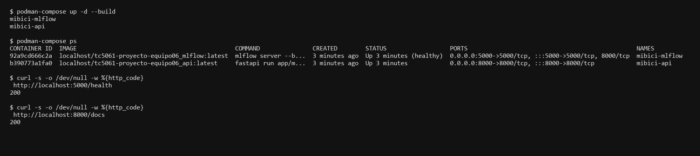
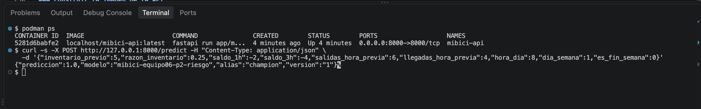
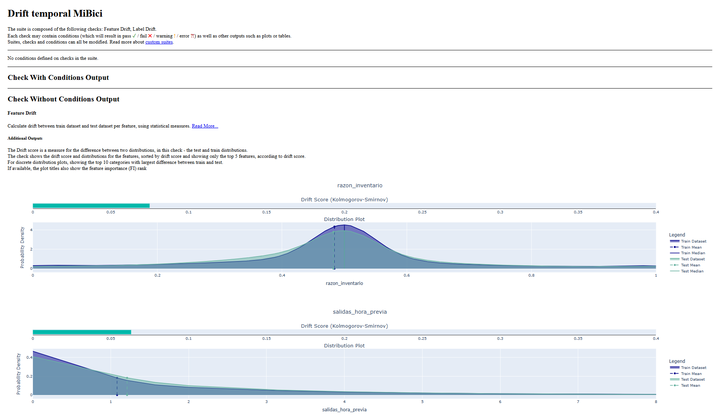
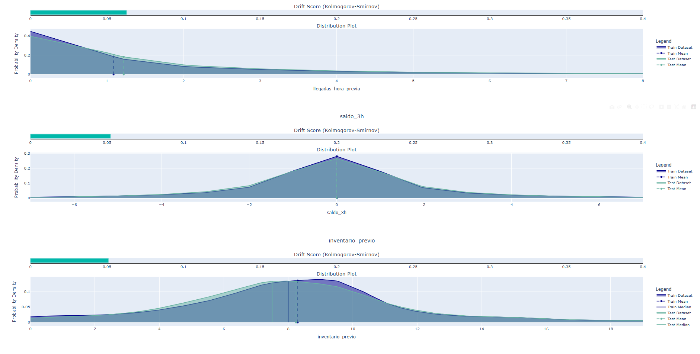
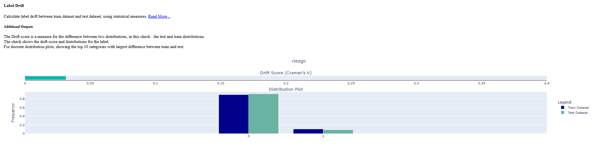
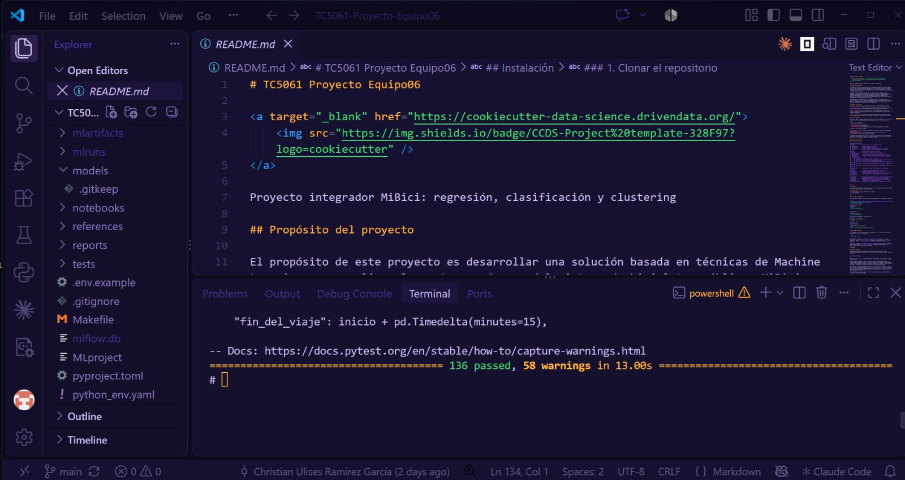
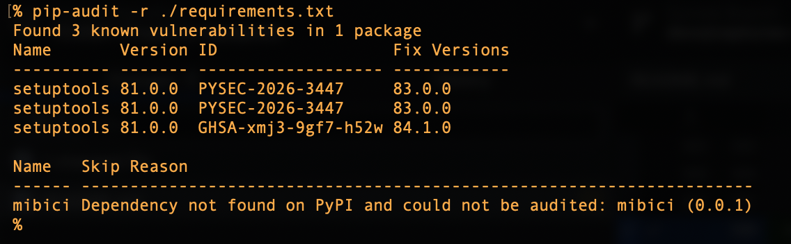
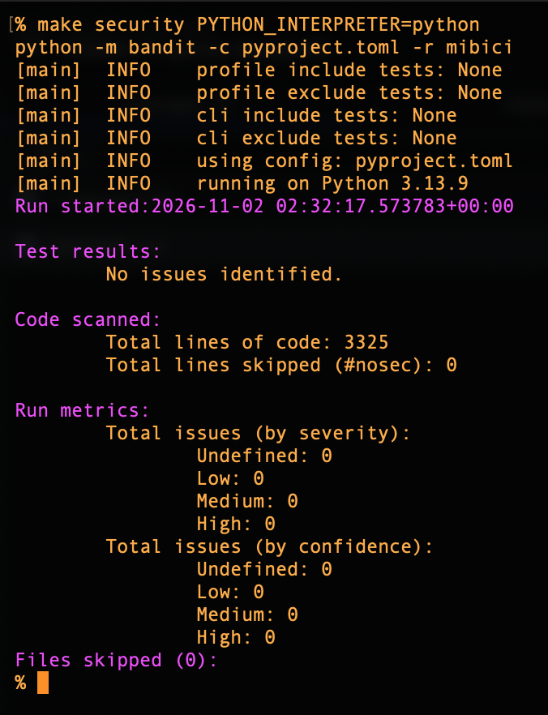
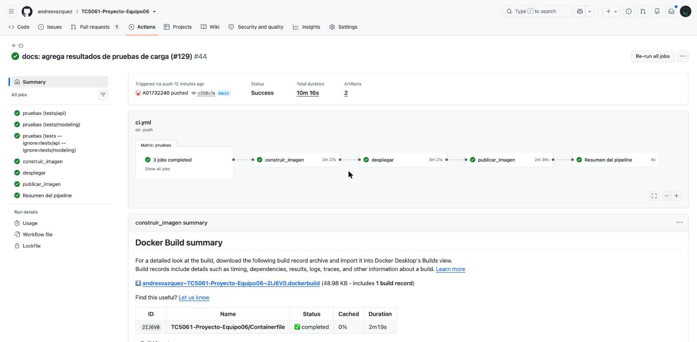
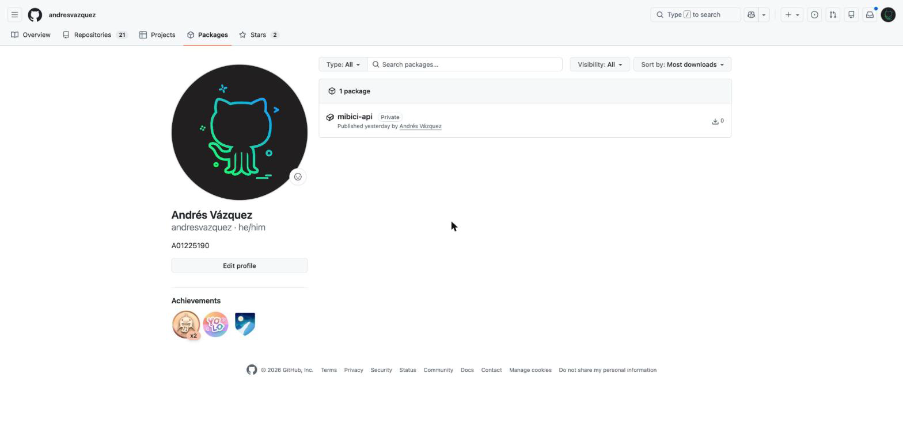

# TC5061 Proyecto Equipo06

<a target="_blank" href="https://cookiecutter-data-science.drivendata.org/">
    
</a>

Proyecto integrador MiBici: regresión, clasificación y clustering

## Propósito del proyecto

El propósito de este proyecto es desarrollar una solución basada en técnicas de Machine Learning para analizar los patrones de uso del sistema de bicicletas públicas MiBici, ubicado en el Área Metropolitana de Guadalajara, con el objetivo de generar información que apoye la toma de decisiones relacionadas con la operación, distribución de bicicletas y planeación del servicio.

A partir del análisis de datos históricos de viajes y de la información de las estaciones, se busca estimar la demanda futura de bicicletas, identificar posibles problemas de disponibilidad y reconocer estaciones que presentan comportamientos de uso similares. Esto permitirá explorar oportunidades para mejorar la asignación de bicicletas, anticipar situaciones que afecten la disponibilidad del servicio y apoyar la planeación de futuras ampliaciones del sistema.

Adicionalmente, el proyecto busca aplicar buenas prácticas de MLOps mediante la construcción de un flujo de trabajo reproducible que incluya la ingesta y preparación de datos, la generación de variables, el entrenamiento y evaluación de modelos, así como el registro y seguimiento de experimentos utilizando MLflow.

## Preguntas del proyecto

El proyecto aborda tres preguntas mediante diferentes técnicas de Machine Learning:

- **P1 - Regresión:** ¿Cuántos viajes se iniciarán en una estación durante la siguiente hora? Se busca anticipar la demanda para mejorar la distribución de bicicletas.

- **P2 - Clasificación:** ¿Una estación estará en riesgo de quedarse sin bicicletas o sin anclajes disponibles durante la siguiente hora? Se busca identificar estaciones que requieran rebalanceo.

- **P3 - Clustering:** ¿Qué estaciones presentan patrones de uso similares y dónde se ubican? Se busca agrupar estaciones para apoyar la planeación y expansión del sistema.

## Datos utilizados

Se utilizan datos históricos del portal de [Datos Abiertos de MiBici](https://mibici.net/es/datos-abiertos/), correspondientes al periodo de **junio de 2023 a septiembre de 2026**.

La base de datos comprende:

- **40 meses** de registros históricos.
- **15,011,969 viajes** registrados.
- **484 estaciones** en la nomenclatura, de las cuales 473 aparecen en los viajes.

Se utilizan dos fuentes principales:

- **Registros de viajes:** archivos CSV mensuales con fechas, horarios y estaciones de origen y destino.
- **Nomenclatura de estaciones:** archivo `nomenclatura_2026_09.csv`, con identificadores, nombres, ubicaciones y capacidades.

Los datos se procesan mediante Python y se almacenan en formato Parquet. Se excluye la información personal de los usuarios y se utiliza un manifiesto con hashes SHA-256 para garantizar la trazabilidad y reproducibilidad de los datos.

## Estructura de carpetas

```
TC5061-Proyecto-Equipo06/
├── .venv/              <- Entorno virtual local (ignorado en Git)
├── .env.example        <- Ejemplo de las variables de entorno (MLFLOW_TRACKING_URI, MLFLOW_PORT y API_PORT)
├── .github/
│   └── workflows/
│       └── ci.yml      <- Pipeline de CI/CD con GitHub Actions: pruebas, imagen, despliegue, publicación y resumen
├── app/                <- API REST con FastAPI para servir el modelo
│   ├── __init__.py
│   ├── main.py         <- Aplicación FastAPI y endpoint POST /predict
│   ├── modelo.py       <- Carga del modelo desde el Model Registry de MLflow
│   ├── prediccion.py   <- Función predecir que ejecuta el modelo
│   └── schemas.py      <- Esquema de entrada con Pydantic (PrediccionEntrada)
├── data/
│   ├── external/       <- Datos de fuentes de terceros
│   ├── interim/        <- Datos intermedios transformados
│   ├── processed/      <- Datasets procesados finales para modelado (.parquet)
│   └── raw/            <- Copias locales de viajes y nomenclatura de estaciones
│
├── docs/               <- Documentación adicional del proyecto
├── mibici/             <- Paquete con el código fuente del proyecto
│   ├── __init__.py
│   ├── config.py       <- Variables globales, rutas e intervalos de fechas
│   ├── dataset.py      <- Ingesta, limpieza, normalización y generación del manifiesto
│   ├── deepchecks_report.py <- Chequeos de validación de datos con DeepChecks
│   ├── features.py     <- Creación de funciones para entrenamiento de los 3 modelos
│   ├── plots.py        <- Gráficas de evaluación de los modelos
│   ├── monitoring/     <- Monitoreo de calidad y drift con Evidently
│   │   ├── __init__.py
│   │   ├── datos_drift.py   <- Construcción de los conjuntos de referencia y actual
│   │   ├── reporte_drift.py <- Reportes de Data Drift y calidad con Evidently
│   │   └── tabla_drift.py   <- Resumen tabular de resultados de drift
│   └── modeling/
│       ├── __init__.py
│       ├── ab_test.py  <- Comparación A/B entre champion y challenger de P2
│       ├── predict.py  <- Código para inferencia de modelos
│       ├── registry.py <- Registro del modelo elegido con el alias champion
│       ├── registry_challenger.py <- Registro de la versión alternativa con alias challenger
│       ├── tracking.py <- Clase RunMLflow para trazabilidad centralizada de experimentos
│       ├── train.py    <- Script base de entrenamiento (no usado)
│       ├── train_dispatcher.py <- Entry point train del MLproject
│       ├── train_p1.py <- Entrenamiento y evaluación de P1
│       ├── train_p2.py <- Entrenamiento y evaluación de P2
│       ├── train_p2_reentrenado.py <- Versión alternativa de P2 para el A/B testing
│       ├── train_p3.py <- Entrenamiento y evaluación de P3
│       ├── train_p3_search.py <- Búsqueda de hiperparámetros de P3
│       ├── train_p3_stability.py <- Estabilidad de los grupos de P3
│       └── version_vigente.py <- Regla para decidir la versión vigente de P2
│
├── mlartifacts/        <- Almacenamiento local de artefactos de MLflow (modelos, gráficas)
├── mlruns/             <- Registro local de ejecuciones y experimentos de MLflow
├── models/             <- Modelos entrenados y serializados
├── notebooks/          <- Notebooks de exploración inicial y validación
├── operacion/          <- Pruebas de carga y análisis de costo de la Semana 10
│   ├── __init__.py
│   ├── costo_inferencia.py   <- Costo por inferencia con 1, 2 y 4 réplicas a partir de Locust y recursos.csv
│   ├── graficas_carga.py     <- Gráficas de latencia, peticiones por segundo y tasa de error
│   ├── locustfile.py         <- Escenario de carga de Locust sobre POST /predict
│   └── registrar_recursos.sh <- Registro de CPU y memoria de los contenedores con docker o podman stats
├── references/         <- Manifiesto de datos (data_manifest.csv) y referencias técnicas
├── reports/            <- Reportes generados y gráficas/artefactos de evaluación
│   ├── ab_test/        <- Comparación Champion vs Challenger de P2
│   │   ├── comparacion_p2.csv
│   │   └── comparacion_p2.json
│   ├── deepchecks/
│   ├── evidently/      <- Reportes de monitoreo con Evidently
│   │   ├── calidad_datos.html
│   │   ├── calidad_datos.json
│   │   ├── data_drift.html
│   │   ├── data_drift.json
│   │   └── tabla_drift.csv
│   ├── figures/
│   ├── finops/         <- Costo por inferencia de la Semana 10
│   │   ├── costo_inferencia.csv          <- Una instancia, con 10, 50 y 100 usuarios
│   │   └── costo_inferencia_replicas.csv <- Con 1, 2 y 4 réplicas
│   ├── locust/         <- Resultados de la prueba de carga con Locust
│   │   ├── locust_10.html, locust_50.html y locust_100.html  <- Reportes HTML de cada corrida
│   │   ├── locust_10_stats.csv, locust_50_stats.csv y locust_100_stats.csv  <- Estadísticas de cada corrida
│   │   ├── locust_10_stats_history.csv, locust_50_stats_history.csv y locust_100_stats_history.csv  <- Historial de cada corrida
│   │   ├── recursos.csv                  <- CPU y memoria de los contenedores durante la prueba
│   │   ├── latencia.png                  <- Latencia mediana y percentil 95
│   │   ├── peticiones_por_segundo.png    <- Peticiones por segundo
│   │   └── tasa_error.png                <- Tasa de error
│   └── security/       <- Reporte de pip-audit
├── tests/              <- Pruebas automatizadas con pytest
│
├── .gitignore          <- Reglas para ignorar datos pesados, entornos y carpetas locales
├── Containerfile       <- Imagen de la API (Python 3.13, FastAPI en el puerto 8000)
├── docker-compose.yml  <- Servicios mlflow y api, con red, volúmenes y puertos por variable de entorno
├── Makefile           <- Comandos automatizados para el ciclo de vida del proyecto
├── MLproject           <- MLflow Project con los entry points ingest y train
├── mlflow.db           <- Base de datos local para el tracking server de MLflow
├── pyproject.toml      <- Configuración del paquete mibici y herramientas del entorno
├── python_env.yaml     <- Entorno que usa mlflow run (Python 3.13 y dependencias)
├── README.md           <- Guía principal de uso y documentación
├── requirements.txt    <- Dependencias del proyecto para la reproducción del entorno
└── SECURITY.md         <- Reglas de seguridad y manejo de credenciales
```

Servicios que levanta `docker-compose.yml`:

| Servicio | Puerto en el host | Variable del puerto | Otras variables |
|---|---|---|---|
| `mlflow` | 5000 | `MLFLOW_PORT` | Ninguna |
| `api` | 8000 | `API_PORT` | `MLFLOW_TRACKING_URI=http://mlflow:5000` dentro de la red `mibici` |

--------

## Instalación

Para configurar el entorno de desarrollo y ejecutar los componentes del proyecto desde un clon limpio del repositorio, sigue estos pasos:

### Pre-requisitos
- **Python 3.13** o superior instalado en el sistema.
- **Git** instalado.

---

### 1. Clonar el repositorio

Clona el repositorio en tu máquina local y posicionate dentro de la carpeta del proyecto:

```bash
git clone [https://github.com/andresvazquez/TC5061-Proyecto-Equipo06.git](https://github.com/andresvazquez/TC5061-Proyecto-Equipo06.git)
cd TC5061-Proyecto-Equipo06
```
Crea un entorno virtual
En windows
```bash
python -m venv .venv
.\.venv\Scripts\Activate.ps1
```

En Linux/MacOS
```bash
python3 -m venv .venv
source .venv/bin/activate
```
Para instalar dependencias y el paquete local
```bash
pip install --upgrade pip
pip install -r requirements.txt
pip install -e .
```
O si tienes Make
```bash
make requirements
```
Y para verificar la instalación:
```bash
python -c "import mibici; print(mibici.__name__)"
```

### Variables de entorno

La configuración local se puede ajustar con un archivo `.env` en la raíz del proyecto. Para crearlo a partir de la plantilla:

```bash
cp .env.example .env
```

En PowerShell se puede usar `Copy-Item .env.example .env`. El archivo `.env` está incluido en `.gitignore` por lo que no se sube a Git. Si no existe, el proyecto usa los valores por defecto de `mibici/config.py`. No agregues credenciales reales a `.env.example`.

La variable principal es `MLFLOW_TRACKING_URI`, que define la dirección del servidor de tracking (por defecto `http://localhost:5000`). Se puede sobrescribir desde `.env` o desde el entorno antes de ejecutar los comandos.

## Comandos

### Ingesta de datos

Para bajar y preparar los datos hay que tener el entorno virtual activo y las dependencias instaladas (se explica en Instalación). Después, desde la raíz del proyecto, se corre:

```
python mibici/dataset.py
```

Otra opción es `make data`, que primero instala lo que está en requirements.txt y luego corre lo mismo.

No hay que hacer nada a mano. El script toma el rango de meses de mibici/config.py (FECHA_INICIO y FECHA_FIN), baja los archivos de viajes y la nomenclatura de estaciones a data/raw, limpia cada mes (nombres de columnas, codificación y fechas, y quita los datos personales) y guarda el resultado en Parquet en la carpeta data/processed.

Al final crea references/data_manifest.csv con la URL, el número de registros y el hash de cada archivo. Ese manifiesto sí se sube a Git y los datos no. La versión de los datos es el hash del manifiesto, se imprime al terminar y se puede sacar otra vez sin descargar nada con calcular_hash(config.MANIFEST_PATH) de dataset.py. Esa es la versión que se puede registrar en MLflow.

Son más de 1 GB, así que la primera vez tarda varios minutos. Si un archivo ya está en data/raw no se vuelve a descargar.

#### Ingesta con mlflow run

La ingesta también se puede lanzar desde el MLflow Project. Con el entorno virtual activo y desde la raíz del proyecto, se corre:

```
mlflow run . -e ingest
```

El entry point ingest corre dataset.py, así que no recibe parámetros: el rango de meses y las rutas salen de config.py. Al terminar imprime la versión de los datos y deja el manifiesto en references/data_manifest.csv, igual que arriba.

Por defecto mlflow run crea un entorno aparte con python_env.yaml y para eso necesita tener pyenv instalado. Si no se tiene, se puede usar el entorno que ya está instalado:

```
mlflow run . -e ingest --env-manager local
```

Si MLFLOW_TRACKING_URI apunta al servidor local, hay que levantarlo antes (se explica en Servidor de tracking). Sin esa variable, mlflow run guarda el run en un mlflow.db local y no necesita servidor.

#### Entrenamiento con mlflow run

El entry point train recibe la pregunta, el modelo y sus hiperparámetros. Con el servidor de tracking levantado (se explica en Servidor de tracking), el entorno virtual activo y desde la raíz del proyecto, un ejemplo para P2 es:

```
mlflow run . -e train -P question=p2 -P model=rf -P n_estimators=50 -P max_depth=10 --experiment-name mibici-equipo06 --env-manager local
```

El flag --experiment-name es necesario: mlflow run crea su run en el experimento Default y los scripts de entrenamiento registran en mibici-equipo06, así que sin el flag MLflow rechaza la corrida porque el experimento activo no coincide. La ingesta no lo necesita porque dataset.py no usa MLflow. Y --env-manager local se usa por la misma razón que en la ingesta, si no se tiene pyenv.

Cada mlflow run lanza un solo modelo (en P2 por ejemplo: baseline, rf, lr, rf-search o rf-features-search). Los hiperparámetros que no se indican con -P toman el valor por defecto del MLproject.

#### Reproducir el modelo elegido de cada pregunta

Con el servidor de tracking levantado, MLFLOW_TRACKING_URI apuntando a él, el entorno virtual activo y desde la raíz del proyecto, estos comandos reproducen el modelo elegido de cada pregunta. Llevan --experiment-name mibici-equipo06 y --env-manager local por lo explicado arriba.

P1 (demanda), HistGradientBoosting con 100 iteraciones:

```
mlflow run . -e train -P question=p1 -P model=hgb -P max_iter=100 --experiment-name mibici-equipo06 --env-manager local
```

P2 (riesgo), Random Forest con variables temporales, 100 árboles y profundidad máxima de 15. El comando lanza la búsqueda de cuatro combinaciones (una corrida padre y cuatro hijas) y el modelo elegido es la hija de 100 árboles y profundidad máxima de 15:

```
mlflow run . -e train -P question=p2 -P model=rf-features-search --experiment-name mibici-equipo06 --env-manager local
```

P3 (grupos), KMeans con tres clusters y 10 inicializaciones:

```
mlflow run . -e train -P question=p3 -P model=kmeans -P n_clusters=3 --experiment-name mibici-equipo06 --env-manager local
```

El baseline de cada pregunta se lanza con -P model=baseline en P1 y P2, y en P3 con el mismo comando sin n_clusters, que toma 4 por defecto.

### Servidor de tracking

El Model Registry necesita un almacenamiento respaldado por una base de datos, así que el tracking se hace contra un servidor local con SQLite. Cada integrante levanta el suyo en su máquina, con el entorno virtual activo y desde la raíz del proyecto, en una terminal aparte que se deja abierta:

```
mlflow server --backend-store-uri sqlite:///mlflow.db --port 5000
```

Esto crea mlflow.db en la raíz (está en .gitignore, no se sube a Git) y deja la interfaz en http://localhost:5000. Esa es la dirección que mibici/config.py toma por defecto en TRACKING_URI, así que no hay que configurar nada más. Si se necesita otra, se cambia con la variable MLFLOW_TRACKING_URI (o en el .env):

```
export MLFLOW_TRACKING_URI=http://localhost:5000
```

### Construir la imagen de la API

Con Podman instalado y desde la raíz del repositorio, la imagen de la API se construye con:

```bash
podman build -t mibici-api -f Containerfile .
```

Para comprobar que la imagen se creó correctamente:

```bash
podman images
```

La imagen debe aparecer con el nombre:

```text
localhost/mibici-api:latest
```

El `Containerfile` utiliza Python 3.13, instala las dependencias definidas en `requirements.txt`, incluye los paquetes `mibici/` y `app/`, expone el puerto 8000 y ejecuta FastAPI en modo de producción.

La imagen no contiene una copia fija del modelo. Al iniciar el contenedor, la API obtiene `mibici-equipo06-p2-riesgo@champion` desde MLflow Model Registry utilizando el servidor configurado mediante `MLFLOW_TRACKING_URI`.

### Levantar el contenedor de la API

La API carga el modelo champion desde el Model Registry, así que el contenedor necesita llegar al servidor de tracking de la máquina. Dentro del contenedor localhost es el propio contenedor, por eso la dirección del registry se pasa con la variable de entorno MLFLOW_TRACKING_URI y apunta a host.containers.internal.

1. Levantar el servidor de tracking con el comando de abajo, en una terminal aparte. MLflow responde 403 (Invalid Host header) a los hosts que no están en --allowed-hosts, y esa lista reemplaza a la que trae por defecto, por eso también incluye localhost y 127.0.0.1:

```
mlflow server --backend-store-uri sqlite:///mlflow.db --host 0.0.0.0 --port 5000 --allowed-hosts "localhost:*,127.0.0.1:*,host.containers.internal:*"
```

2. Levantar el contenedor con la imagen mibici-api, publicando el puerto 8000 y con la dirección del registry:

```
podman run -d --name mibici-api -p 8000:8000 -e MLFLOW_TRACKING_URI=http://host.containers.internal:5000 mibici-api
```

3. Confirmar que el contenedor está corriendo y que cargó el modelo. Si falla, el error aparece en los logs:

```
podman ps -a
podman logs mibici-api
```

4. Abrir http://127.0.0.1:8000/docs para probar POST /predict desde Swagger UI.

Para volver a levantarlo con el mismo nombre primero se elimina el contenedor anterior:

```
podman stop mibici-api
podman rm mibici-api
```

Con Docker la secuencia es la misma cambiando podman por docker, pero host.containers.internal es la dirección del host en Podman. Para Docker hay que verificar la dirección equivalente en su documentación antes de usar el mismo valor en MLFLOW_TRACKING_URI.

### Levantar el sistema con Docker Compose

Desde la raíz del repositorio, el archivo `docker-compose.yml` levanta el servidor de tracking y la API en un solo paso:

```bash
docker compose up -d --build
```

Con Podman se instala `podman-compose` y se usa el mismo archivo:

```bash
pip3 install podman-compose
podman-compose up -d --build
```

En macOS, `podman-compose` también se puede instalar con `brew install podman-compose`. Los puertos expuestos se pueden cambiar copiando `.env.example` a `.env` y ajustando `MLFLOW_PORT` y `API_PORT`.

Los servicios son:

- `mlflow`: servidor de tracking en `http://localhost:5000`. Usa `mlflow.db` como base de datos y sirve los artefactos desde `./mlartifacts`, que se monta en `/app/mlartifacts`; por eso el comando incluye `--default-artifact-root ./mlartifacts`.
- `api`: FastAPI en `http://127.0.0.1:8000`. Dentro de la red `mibici` usa `MLFLOW_TRACKING_URI=http://mlflow:5000` para cargar el modelo `mibici-equipo06-p2-riesgo@champion` del Model Registry.

Para verificar que ambos quedaron arriba:

```bash
docker compose ps
curl -s -o /dev/null -w "%{http_code}\n" http://localhost:5000/health
curl -s -o /dev/null -w "%{http_code}\n" http://localhost:8000/docs
```

Con Podman, los mismos comandos se escriben con `podman-compose` en lugar de `docker compose`. Las respuestas esperadas son `200` en `/health` y en `/docs`; la API tarda unos segundos en descargar el modelo champion. Si el registro local tiene artefactos con rutas absolutas de Windows, hay que volver a registrar o promover el modelo con el servidor de Compose para que los artefactos queden bajo `mlartifacts/`; de lo contrario `/predict` responderá `503`.



Para detener los servicios sin borrar la base ni los artefactos locales:

```bash
docker compose down
```

o, con Podman:

```bash
podman-compose down
```

### Ejemplo de petición y respuesta

Con el contenedor en ejecución, se envía una estación de ejemplo con las nueve variables que usa el modelo de P2:

```bash
curl -X POST http://127.0.0.1:8000/predict \
  -H "Content-Type: application/json" \
  -d '{"inventario_previo": 5, "razon_inventario": 0.25, "saldo_1h": -2, "saldo_3h": -4, "salidas_hora_previa": 6, "llegadas_hora_previa": 4, "hora_dia": 8, "dia_semana": 1, "es_fin_semana": 0}'
```

La API respondió HTTP 200 con:

```json
{"prediccion":1.0,"modelo":"mibici-equipo06-p2-riesgo","alias":"champion","version":"1"}
```

`prediccion=1.0` indica que el modelo clasificó la estación como en riesgo durante la siguiente hora. Los campos `modelo`, `alias` y `version` confirman que la respuesta proviene de `mibici-equipo06-p2-riesgo@champion`, versión 1 del Model Registry.

En Windows, ejecutar el comando desde Git Bash/WSL o usar `curl.exe`; en PowerShell `curl` es un alias de `Invoke-WebRequest`.



### Estrategia de despliegue

Se eligió inferencia en tiempo real (predicción en línea): la API recibe en un POST las variables de una estación y responde de inmediato. La pregunta de P2 es sobre el riesgo en la siguiente hora, así que se necesita el dato del momento, y una predicción por lotes generada con anticipación podría quedar desactualizada. Empaquetar el servicio en un contenedor reduce las diferencias entre entornos y facilita un despliegue reproducible.

### Experimento base

Con los datos ya descargados (sección anterior), el entorno virtual activo y desde la raíz del proyecto, primero se levanta MLflow en otra terminal:

```
mlflow ui --backend-store-uri sqlite:///mlflow.db
```

La dirección sale de mibici/config.py (http://localhost:5000) y se puede cambiar con la variable MLFLOW_TRACKING_URI. Con MLflow arriba se corren los tres baselines, uno por pregunta, en este orden:

```
python -m mibici.modeling.train_p3
python -m mibici.modeling.train_p1
python -m mibici.modeling.train_p2
```

P3 tarda unos segundos, P1 alrededor de medio minuto y P2 unos minutos. No hay que hacer nada a mano ni abrir notebooks: cada script lee los datos, construye las variables con mibici/features.py, entrena y registra todo en MLflow.

Al terminar, en el experimento mibici-equipo06 quedan 5 runs: Baseline_P1_Lag168 y Candidato_HistGradientBoosting (P1), p2-baseline-clase-mas-frecuente y p2-random-forest (P2) y p3-baseline-kmeans-volumen (P3). Cada uno registra:

- Parámetros para reproducirlo: rango de fechas, versión de los datos, semilla, modelo e hiperparámetros.
- Métricas con el conjunto en el nombre, como val_mae, test_recall o train_silhouette.
- Etiquetas con el equipo, la pregunta (P1, P2 o P3) y el commit de Git con que se ejecutó.
- Artefactos: las gráficas de P1, las curvas precision-recall de P2 y el modelo KMeans con el resumen de grupos de P3.

Con la versión de datos 723b4c4628046549dce640dabba90372588f9ea49fc882fecee42a5e1afedd7a se espera, en P1, un val_mae de 0.7738 en el baseline y de 0.6348 en el candidato; en P2, un recall de validación de 0.8853 en el random forest (el baseline no detecta riesgo); y en P3, una silueta de 0.5985 y un Davies-Bouldin de 0.5064.

### Validación de datos con DeepChecks

Los chequeos de calidad de datos se ejecutan con:

`python -m mibici.deepchecks_report`

El análisis reutiliza la malla y la partición temporal de P2 definida en el proyecto. Se evalúan los conjuntos reales de entrenamiento y prueba mediante los siguientes checks de DeepChecks:

- `PercentOfNulls`: porcentaje de valores faltantes.
- `MixedDataTypes`: detección de columnas con tipos mezclados.
- `DataDuplicates`: detección de filas duplicadas.
- `FeatureDrift`: comparación de las distribuciones de las variables entre entrenamiento y prueba.
- `LabelDrift`: comparación de la distribución de la etiqueta `riesgo` entre entrenamiento y prueba.

Para los checks de drift se utiliza una muestra reproducible de 100,000 filas de entrenamiento y 100,000 filas de prueba, utilizando la semilla centralizada en `config.SEMILLA`.

La ejecución genera los resultados en `reports/deepchecks/`. El resumen cuantitativo se almacena en:

`reports/deepchecks/resumen_deepchecks.json`

Los reportes HTML permiten inspeccionar visualmente los resultados de integridad y drift.

#### Problemas inyectados en las pruebas

Las pruebas de `tests/test_deepchecks_*.py` trabajan con tablas pequeñas. A cada tabla se le mete a propósito un problema para comprobar que el chequeo lo detecta, y se repite con la tabla limpia para confirmar que ahí no avisa de nada. Esto es lo que se prueba en cada caso:

- `data_integrity`: se le pide una etiqueta que no existe en la tabla y DeepChecks lanza `DeepchecksValueError`. Con la etiqueta correcta, la suite corre y regresa sus resultados.
- `DataDuplicates`: se repiten 10 filas. La proporción de duplicados sale como 10 entre el total de filas, y en la tabla limpia sale 0. La condición de cero duplicados pasa en la limpia y falla con las repetidas.
- `MixedDataTypes`: se crea una columna con la mitad de los valores como texto y la otra mitad como números, y el chequeo reporta esa mezcla. Con solo 5 % de texto, la condición de que el texto quede entre 1 % y 10 % no pasa.
- `PercentOfNulls`: se ponen 5 valores `NaN` en `saldo_1h` y la proporción detectada es 5 entre el total de filas. La condición de cero nulos pasa en la tabla limpia y falla con un solo `NaN`.
- `MixedNulls`: se crea una columna con un `NaN` y un valor escrito como `"null"`, y el chequeo encuentra las dos formas de marcar un faltante, con dos registros en total.
- `FeatureDrift` y `LabelDrift`: se desplaza una variable (media 0 en entrenamiento y 5 en prueba) y se cambia la etiqueta (de 50 % a 90 % de riesgo). Con distribuciones iguales el drift score es 0, y con las alteradas sale mayor que 0.2. La condición de umbral 0.2 pasa sin drift y falla con drift.

#### Resultados sobre los datos reales

La ejecución se realizó sobre 11,424,960 filas de entrenamiento y 1,015,680 filas de prueba.

En las variables analizadas no se detectaron valores faltantes, filas duplicadas ni columnas con tipos mixtos en entrenamiento o prueba.

Los drift scores observados para las variables numéricas fueron:

- `inventario_previo`: 0.05108
- `razon_inventario`: 0.07505
- `saldo_1h`: 0.03136
- `saldo_3h`: 0.05239
- `salidas_hora_previa`: 0.06318
- `llegadas_hora_previa`: 0.06288

La variable con mayor drift observado fue `razon_inventario`, con 0.07505. La comparación se realizó mediante la estadística Kolmogorov-Smirnov reportada por DeepChecks.

Para la etiqueta `riesgo`, DeepChecks reportó un drift score de 0.03144 mediante Cramer's V.

Estos resultados no mostraron problemas de integridad en las variables analizadas y los cambios de distribución observados entre entrenamiento y prueba fueron menores que los utilizados en las pruebas automatizadas para representar escenarios de drift alto.

#### Evidencia de ejecución

Las siguientes capturas muestran el análisis de drift temporal generado por DeepChecks sobre los conjuntos reales de entrenamiento y prueba.







La visualización compara las distribuciones de entrenamiento y prueba. Entre las variables analizadas, `razon_inventario` presentó el mayor drift score observado, con `0.07505`.

### Monitoreo de drift

Para el monitoreo con Evidently se necesita un conjunto actual que represente el comportamiento en producción. La API (`app/main.py` y `app/prediccion.py`) no registra las peticiones que recibe: el endpoint `POST /predict` devuelve la predicción junto con el modelo, el alias y la versión, y no guarda las entradas. Por eso el conjunto actual no sale de registros de la API, sino de los datos abiertos de MiBici.

**Periodos elegidos.** Antes de generar el reporte se definieron los dos conjuntos que se comparan, a partir de los cortes de `mibici/config.py`. Ambos son de la malla estación por hora de P2 (`mibici/monitoring/datos_drift.py`) y salen de los datos abiertos de MiBici ya procesados en `data/processed`:

| Conjunto | Fechas | Filas del periodo (antes del muestreo) | Filas en el reporte (muestra) | De dónde sale |
|---|---|---|---|---|
| Referencia | 2023-06 a 2026-03 (`hora < INICIO_VALIDACION`) | 11,424,960 | 100,000 | `conjunto_referencia()` |
| Actual | 2026-07 a 2026-09 (`hora >= INICIO_PRUEBA`) | 1,015,680 | 100,000 | `conjunto_actual()` |

**Por qué estos periodos.** La referencia es el periodo con el que se entrenó el modelo registrado (`mibici-equipo06-p2-riesgo`), así que representa los datos que el modelo conoce. El actual es el trimestre posterior más reciente de los datos abiertos: es posterior al entrenamiento y a la validación (2026-04 a 2026-06), y el modelo no lo vio al entrenar. Es el periodo de prueba de `config.py`, de modo que el A/B testing de P2 usa el mismo conjunto. Los periodos no se escogieron para que salga drift ni se cambiaron al ver los resultados: el reporte se lee tal como sale.

**Muestreo.** Los dos periodos tienen cientos de miles o millones de filas, así que cada uno se muestrea con `df.sample(n=100_000, random_state=config.SEMILLA)` (`MUESTRA_DRIFT` en `datos_drift.py`). La semilla fija hace que salga la misma muestra en cada corrida. Es la misma regla que usa `mibici/deepchecks_report.py`.

**Cómo correr el reporte.** Con el entorno activo y desde la raíz del proyecto:

```bash
python -m mibici.monitoring.reporte_drift
```

Genera en `reports/evidently/` dos reportes completos en HTML, que se abren en el navegador, junto con su JSON:
- `data_drift.html` y `data_drift.json`: el drift por variable.
- `calidad_datos.html` y `calidad_datos.json`: el resumen y los tests de calidad de los datos.

**Qué contiene el reporte.** El de drift (`DataDriftPreset` de Evidently) compara cada variable del conjunto actual contra la de referencia. Para las numéricas usa la distancia de Wasserstein normalizada y para las categóricas (`es_fin_semana` y `riesgo`) la distancia de Jensen-Shannon, ambas con umbral de 0.1. Una variable tiene drift si su distancia alcanza o supera el umbral, y el dataset completo tiene drift si lo tiene al menos la mitad de las columnas (`drift_share=0.5`). Se analizan las 9 variables del modelo y la etiqueta `riesgo`.

El de calidad (`DataSummaryPreset` con `include_tests`) resume cada columna y ejecuta tests automáticos sobre faltantes y estadísticas descriptivas, y complementa los chequeos de DeepChecks.

En la corrida que está guardada en `reports/evidently/data_drift.json`, 0 de las 10 columnas superan el umbral de 0.1.

### Registro del modelo elegido

Con el servidor de tracking arriba, el modelo elegido de cada pregunta se registra en el Model Registry con mibici/modeling/registry.py. Se le pasa la pregunta y el ID de la corrida ganadora, que se ve en la interfaz de MLflow:

```
python -m mibici.modeling.registry --question p1 --run-id <run_id>
```

Registra el modelo con su descripción, su linaje (corrida, experimento, commit de Git y versión de los datos) y el alias champion. En el registro quedan mibici-equipo06-p1-demanda, mibici-equipo06-p2-riesgo y mibici-equipo06-p3-grupos, y cada uno se carga con models:/<nombre>@champion.

En P2 la corrida también guarda el umbral de las alertas de riesgo (parámetro umbral) y las métricas con ese umbral, con el sufijo _umbral, junto con las falsas alarmas. El umbral es el más alto con el que el recall de validación todavía llega a RECALL_MINIMO de mibici/config.py (0.85), para reducir las falsas alarmas sin dejar de detectar las estaciones en riesgo. El modelo registrado predice con 0.5, así que para usar el umbral se aplica predict_proba >= umbral, y el valor se guarda como etiqueta umbral en la versión registrada.

### Versión alternativa y A/B testing

Para el monitoreo de P2 se entrena una segunda versión del modelo y se compara con la vigente. La versión alternativa es el mismo random forest del champion (100 árboles y profundidad máxima de 15), entrenado con los datos de junio de 2023 a junio de 2026, es decir, entrenamiento y validación juntos. Los datos de julio a septiembre de 2026 no entran al entrenamiento de ninguna de las dos versiones, porque con ellos se evalúa la comparación.

Con el servidor de tracking arriba, se entrena y se registra como una nueva versión del mismo modelo, con el alias challenger. El alias champion no se mueve:

```
python -m mibici.modeling.train_p2_reentrenado
python -m mibici.modeling.registry_challenger --run-id <run_id>
```

En un registro que solo tiene el modelo original, el champion queda en la versión 1 y el challenger en la versión 2.

La comparación se corre con mibici/modeling/ab_test.py:

```
python -m mibici.modeling.ab_test
```

Carga las dos versiones por alias (models:/mibici-equipo06-p2-riesgo@champion y @challenger) y las evalúa con la misma muestra de 100,000 filas del periodo actual (julio a septiembre de 2026), prediciendo con el umbral de 0.5 en las dos. Calcula las mismas métricas que el entrenamiento (precisión, recall, F1, PR-AUC y falsas alarmas), las guarda en reports/ab_test/comparacion_p2.csv y comparacion_p2.json y registra la corrida en MLflow. Es una comparación champion y challenger sobre el mismo conjunto, no un reparto de tráfico real entre las versiones.

La regla para decidir la versión vigente se fijó antes de correr la comparación y está en mibici/modeling/version_vigente.py. El recall decide y las falsas alarmas desempatan. Una versión solo puede quedar vigente si su recall es de al menos 0.85 (RECALL_MINIMO de mibici/config.py). La alternativa sustituye a la vigente si su recall la supera por 0.01 o más sin que las falsas alarmas suban más de 5 %, o si su recall no baja y sube menos de 0.01 mientras las falsas alarmas bajan 5 % o más. En cualquier otro caso la diferencia se trata como ruido y la versión vigente se queda.

Resultados sobre julio a septiembre de 2026:

| Versión | Alias | Precisión | Recall | F1 | PR-AUC | Falsas alarmas |
|---|---|---|---|---|---|---|
| 1 | champion | 0.3274 | 0.9084 | 0.4814 | 0.6332 | 15,953 |
| 2 | challenger | 0.3310 | 0.9065 | 0.4849 | 0.6341 | 15,669 |

El recall de la versión alternativa es 0.0019 menor que el de la vigente y sus falsas alarmas bajan 1.8 %, lejos del 5 %. Con la regla, el champion se queda como versión vigente y no se mueve ningún alias.

## Model Registry y linaje de P2

El modelo de P2 (riesgo de una estación en la siguiente hora) está en el Model Registry de MLflow con el nombre mibici-equipo06-p2-riesgo. El estado de producción lo define el alias champion; no se usan las etapas Staging y Production.

| Versión | Alias | Qué es |
|---|---|---|
| 1 | champion | Modelo elegido de P2: Random Forest de 100 árboles y profundidad máxima de 15 |
| 2 | challenger | Versión alternativa reentrenada con datos hasta junio de 2026 |

El A/B testing (sección anterior) mantuvo el champion, así que el alias no se movió.

### Cómo pide el modelo la API

app/modelo.py carga el modelo con la dirección models:/mibici-equipo06-p2-riesgo@champion y app/main.py consulta al arrancar qué versión tiene ese alias. Cada respuesta de POST /predict incluye modelo, alias y version, como en el ejemplo de petición y respuesta de arriba. Si el modelo no se pudo cargar, la API responde 503 con el mensaje Modelo no disponible. Como el modelo y la versión se leen una sola vez al arrancar, si el alias cambia de versión hay que reiniciar el servicio api.

### Dónde ver el linaje

En la interfaz de MLflow, en Models, mibici-equipo06-p2-riesgo, al abrir una versión se ven estos tags, que guardan mibici/modeling/registry.py (champion) y mibici/modeling/registry_challenger.py (challenger):

| Tag | Qué contiene | En champion | En challenger |
|---|---|---|---|
| source_run_id | ID de la corrida de origen | Sí | Sí |
| source_experiment_id y source_experiment_name | Experimento de origen | Sí | No |
| git_commit | Commit de Git con el que se entrenó | Sí | Sí |
| version_datos | Hash SHA-256 de references/data_manifest.csv | Sí | Sí |
| umbral | Umbral de las alertas de riesgo | Sí | No |

## Pruebas automatizadas

Todas las pruebas del proyecto se ejecutan con un solo comando, desde la raíz del repositorio y con el entorno virtual activo:

```bash
pytest
```

Pytest encuentra solo los archivos `test_*.py` dentro de `tests/`. No necesita la carpeta `data/` (está en `.gitignore`): las pruebas crean sus propias tablas pequeñas dentro del código. Al terminar, todas deben aparecer como `passed`.

Para correr solo una parte:

```bash
pytest tests/test_features.py        # feature engineering
pytest tests/test_utilidades.py      # utilidades: dispatcher y tracking
pytest tests/modeling                # entrenamiento y reproducibilidad
pytest -k deepchecks                 # validación de datos con DeepChecks
```

| Archivo | Qué verifica |
|---|---|
| `tests/test_features.py` | Funciones de `mibici/features.py`: malla estación por hora, etiqueta de riesgo, variables de P2, rezagos y perfil de uso |
| `tests/test_utilidades.py` | `validar_modelo`, `construir_comando` y `parse_args` (dispatcher) y `obtener_git_commit` (tracking) |
| `tests/test_dataset.py` | Descarga, normalización y manifiesto de datos |
| `tests/modeling/` | Entrenamiento y reproducibilidad: misma semilla, mismos resultados |
| `tests/test_deepchecks_*.py` | Base común de DeepChecks y revisión de nulos, tipos de datos, duplicados y drift entre entrenamiento y prueba |



## Chequeos de seguridad

### Instalación de las herramientas

`pip-audit` y `bandit` ya están en `requirements.txt`, así que se instalan con el resto de las dependencias, con el entorno virtual activo:

```bash
pip install -r requirements.txt
```

Para comprobar que quedaron instaladas:

```bash
pip-audit --version
python -m bandit --version
```

### Auditoría de dependencias con pip-audit

Revisa las librerías de `requirements.txt` contra una base pública de vulnerabilidades conocidas:

```bash
pip-audit -r requirements.txt
```

Termina con código `1` si encuentra alguna vulnerabilidad y con `0` si no hay ninguna. Para guardar el reporte (`-f` indica el formato y `-o` el archivo de salida):

```bash
mkdir -p reports/security
pip-audit -r requirements.txt -f json -o reports/security/pip_audit.json
```

La línea `mibici ... could not be audited` es normal: es el paquete local (`-e .`), que no está en PyPI.

La siguiente captura muestra la ejecución de `pip-audit`. Solo reporta `setuptools`, que se mantiene en 81.0.0 porque `deepchecks` 0.19.1 necesita `pkg_resources` para importarse y las versiones corregidas de `setuptools` ya no lo incluyen.



### Análisis de código con bandit

Busca patrones inseguros en el código de `mibici/`, salvo los directorios excluidos en la sección `[tool.bandit]` de `pyproject.toml`:

```bash
python -m bandit -c pyproject.toml -r mibici
```

Para guardar la salida:

```bash
mkdir -p reports/security
python -m bandit -c pyproject.toml -r mibici -f json -o reports/security/bandit.json
```

La siguiente captura muestra la ejecución de `bandit` sobre `mibici/`, sin hallazgos:



## Pipeline de CI/CD

El workflow `.github/workflows/ci.yml` se ejecuta con GitHub Actions en cada `push` y en cada `pull request`. Tiene los siguientes jobs. `desplegar` y `publicar_imagen` solo corren cuando el `push` es a `main`:

| Job | Cuándo corre | Qué hace |
|---|---|---|
| `pruebas` | Push y pull request | Instala las dependencias con caché de pip y corre `pytest` en una matriz de tres grupos: `tests/api`, `tests/modeling` y el resto |
| `construir_imagen` | Push y pull request, después de `pruebas` | Construye la imagen con el `Containerfile` sin publicarla |
| `desplegar` | Push a `main`, después de `pruebas` y `construir_imagen` | Levanta el sistema con `docker compose up -d --build`, comprueba que MLflow responde en `/health` y la API en `/docs`, y baja los servicios |
| `publicar_imagen` | Push a `main`, después de `desplegar` | Inicia sesión en `ghcr.io` y publica la imagen `ghcr.io/andresvazquez/mibici-api:latest` |
| `notificar` (Resumen del pipeline) | Siempre, al final, aunque otro job falle | Escribe en el resumen de la ejecución una tabla con el resultado de cada job |

En el runner no existe `mlflow.db`, así que `desplegar` crea un archivo vacío y la carpeta `mlartifacts` antes de levantar Compose. Con ese registro vacío la API arranca sin modelo: el despliegue comprueba que los servicios se levantan y se comunican, pero no la predicción.

### Secreto para publicar la imagen

El job `publicar_imagen` necesita el secreto `GH_REGISTRY` en el repositorio (Settings, Secrets and variables, Actions). Es un token personal con el permiso `write:packages` y se usa como contraseña en el inicio de sesión de `ghcr.io`. Si el secreto no existe o venció, el job falla en el login.

### Cómo ver el resultado

1. Abrir la pestaña **Actions** del repositorio.
2. Elegir el workflow **CI** y la ejecución que se quiere revisar.
3. Abrir un job para ver sus pasos y el registro de cada uno. Una marca verde indica que el job terminó bien y una roja, que falló en alguno de sus pasos.
4. Al final de la página de la ejecución aparece el **Resumen del pipeline**, con el resultado de cada job en una sola tabla.

La siguiente captura muestra la ejecución de `main` con todos los jobs en verde:



Con `publicar_imagen` en verde, la imagen queda publicada en el registro de contenedores de GitHub, en la sección Packages del perfil, como `mibici-api`:



### Correr lo mismo en local

Los jobs repiten comandos que se pueden ejecutar desde la raíz del repositorio:

```bash
pytest
podman build -t mibici-api -f Containerfile .
docker compose up -d --build
docker compose down
```

El primero equivale a `pruebas`, el segundo a `construir_imagen` y los dos últimos a `desplegar`. A diferencia del runner, en local el registro de modelos sí existe, así que la API carga el champion al arrancar.

## Pruebas de carga y consumo de recursos

Se realizaron pruebas de carga sobre `POST /predict` utilizando Locust contra la API desplegada localmente con MLflow y FastAPI en contenedores.

Antes de iniciar las mediciones se verificó que el modelo `mibici-equipo06-p2-riesgo@champion`, versión 1, estuviera cargado correctamente y que el endpoint respondiera predicciones válidas.

El escenario utiliza las nueve variables de P2 y un `wait_time` aleatorio de 1 a 3 segundos entre solicitudes.

Se realizaron tres corridas de 60 segundos con cargas crecientes:

| Usuarios | Spawn rate | Duración | Requests | RPS | Mediana | P95 | Error |
|---:|---:|---:|---:|---:|---:|---:|---:|
| 10 | 2 usuarios/s | 60 s | 288 | 5.34 | 63 ms | 110 ms | 0.00% |
| 50 | 10 usuarios/s | 60 s | 1,365 | 24.15 | 100 ms | 310 ms | 0.00% |
| 100 | 20 usuarios/s | 60 s | 1,952 | 34.48 | 990 ms | 1,500 ms | 0.00% |

Las pruebas se ejecutaron en modo headless. Por ejemplo, para 100 usuarios:

```bash
locust \
  -f operacion/locustfile.py \
  --headless \
  --host http://127.0.0.1:8000 \
  --users 100 \
  --spawn-rate 20 \
  --run-time 60s \
  --csv reports/locust/locust_100 \
  --csv-full-history \
  --html reports/locust/locust_100.html
```

El consumo de recursos de los contenedores se registró cada 2 segundos durante las pruebas.

| Usuarios | CPU API promedio | CPU API máximo | RAM API promedio | RAM API máxima |
|---:|---:|---:|---:|---:|
| 10 | 7.81% | 10.07% | 937.9 MB | 938.3 MB |
| 50 | 18.63% | 25.40% | 941.0 MB | 942.5 MB |
| 100 | 33.58% | 40.63% | 950.3 MB | 951.9 MB |

Entre 10 y 50 usuarios el servicio aumenta su throughput de 5.34 a 24.15 solicitudes por segundo manteniendo una mediana de latencia de 100 ms. Con 100 usuarios, el throughput aumenta a 34.48 solicitudes por segundo, pero la mediana llega a 990 ms y el percentil 95 a 1.5 s.

Esto muestra un punto de degradación entre 50 y 100 usuarios concurrentes: el throughput continúa aumentando, pero la latencia crece de forma considerable. No se observaron errores HTTP durante ninguna de las tres corridas y el consumo de memoria de la API se mantuvo estable alrededor de 1 GB.

Los artefactos completos de las pruebas se encuentran en `reports/locust/`, incluyendo los CSV, reportes HTML de Locust, mediciones de recursos y gráficas de latencia, peticiones por segundo y tasa de error.

## Análisis FinOps

Estimación del costo por inferencia del sistema (API y servidor de MLflow) a partir de la prueba de carga con Locust y el registro de recursos.

### Supuestos

- *Instancia de referencia:* AWS EC2 t3.medium (2 vCPU y 4 GiB), Linux, región US East (N. Virginia), bajo demanda.
- *Precio:* $0.0418 por hora, tomado de la página oficial de AWS (https://aws.amazon.com/ec2/instance-types/t3/), consultada el 22 de noviembre de 2026. Está en la constante PRECIO_HORA_USD de operacion/costo_inferencia.py.
- *Carga:* peticiones por segundo medidas en las corridas de 10, 50 y 100 usuarios (60 segundos cada una). Las mediciones se hicieron en una máquina local, no en la instancia de AWS, así que las cifras no se trasladan exactamente.
- *CPU realmente usada:* suma de la CPU promedio de mibici-api y mibici-mlflow, entre 200% (2 vCPU).
- *Réplicas:* cada réplica cuesta una instancia completa y las peticiones por segundo escalan en línea recta.
- No incluye almacenamiento, transferencia de red ni cargos adicionales de las instancias T3.

### Fórmula

- Peticiones por hora = peticiones por segundo × 3600
- Costo por inferencia = costo por hora de la instancia ÷ peticiones por hora
- Costo por inferencia con CPU usada = costo por inferencia × fracción de CPU usada
- Con N réplicas: costo por hora = N × precio por hora; peticiones por segundo = N × las de una réplica

### Cómo ejecutarlo

Con el entorno virtual activo y desde la raíz del proyecto:

bash
python -m operacion.costo_inferencia


Imprime las tablas y las guarda en reports/finops/: costo_inferencia.csv (una instancia) y costo_inferencia_replicas.csv (1, 2 y 4 réplicas).

### Costo por inferencia con una instancia (USD)

| Usuarios | Peticiones/s | Mediana | P95 | Peticiones/hora | Costo por inferencia | Con CPU usada |
|---|---|---|---|---|---|---|
| 10 | 5.34 | 63 ms | 110 ms | 19,212 | 2.18e-06 | 4.08e-07 |
| 50 | 24.15 | 100 ms | 310 ms | 86,939 | 4.81e-07 | 9.66e-08 |
| 100 | 34.48 | 990 ms | 1,500 ms | 124,139 | 3.37e-07 | 8.54e-08 |

### Costo con 1, 2 y 4 réplicas (USD)

| Usuarios | Réplicas | Peticiones/hora | Costo por hora | Costo por inferencia |
|---|---|---|---|---|
| 10 | 1 | 19,212 | 0.0418 | 2.18e-06 |
| 10 | 2 | 38,425 | 0.0836 | 2.18e-06 |
| 10 | 4 | 76,850 | 0.1672 | 2.18e-06 |
| 50 | 1 | 86,939 | 0.0418 | 4.81e-07 |
| 50 | 2 | 173,879 | 0.0836 | 4.81e-07 |
| 50 | 4 | 347,758 | 0.1672 | 4.81e-07 |
| 100 | 1 | 124,139 | 0.0418 | 3.37e-07 |
| 100 | 2 | 248,279 | 0.0836 | 3.37e-07 |
| 100 | 4 | 496,558 | 0.1672 | 3.37e-07 |

Las réplicas aumentan la capacidad, pero no cambian el costo por inferencia. Lo que lo baja es la carga: pasa de 2.18e-06 con 10 usuarios a 3.37e-07 con 100 usuarios.

### Optimizaciones propuestas

El desarrollo y el ahorro estimado de cada una están en el reporte.

- *Que el sistema quepa en una instancia más pequeña:* la API y MLflow usan unos 3.3 GB y solo 25.4% de la CPU, así que la memoria es el límite (MLflow ocupa unos 2.3 GB y la API unos 950 MB).
- *Aprovechar la segunda vCPU con más de un proceso en la API:* la CPU máxima de la API fue 40.6% con 100 usuarios; es una hipótesis que hay que probar.
- *Agregar réplicas solo si la latencia lo exige:* con 1, 2 o 4 réplicas el costo por inferencia es el mismo (bajo el supuesto de escalamiento lineal), y el P95 pasa de 310 ms a 1,500 ms entre 50 y 100 usuarios.

## Model Card

### Model Details

El modelo registrado es `mibici-equipo06-p2-riesgo`, versión 1 con el alias `champion`. Es un Random Forest de clasificación binaria con 100 árboles, profundidad máxima de 15, pesos de clase 0.1 para la clase normal y 0.9 para la clase de riesgo, y semilla 42. La corrida de origen es `p2-rf-features-trial-2`, dentro del experimento `mibici-equipo06`, y usa nueve variables por estación y hora. El linaje completo —corrida, commit y versión de datos— queda en las etiquetas de la versión registrada y en MLflow Tracking.

### Intended Use

El modelo estima, con una hora de anticipación, si una estación de MiBici estará en riesgo de quedarse sin bicicletas o sin anclajes disponibles. La salida apoya las decisiones de rebalanceo del equipo operativo. Se sirve desde la API FastAPI mediante el endpoint `POST /predict`, que carga el modelo como `models:/mibici-equipo06-p2-riesgo@champion` y devuelve la predicción junto con el modelo, el alias y la versión.

### Out-of-Scope Uses

Este modelo no predice la demanda de viajes de P1, no agrupa estaciones como P3 y no decide automáticamente rutas de rebalanceo. Tampoco está pensado para estaciones sin capacidad informada, para periodos fuera del rango de datos usado o para operar sin supervisión humana cuando la precisión sea baja. Las probabilidades del modelo no deben interpretarse como un costo o una garantía de disponibilidad.

### Training Data

Los datos son del portal de Datos Abiertos de MiBici: 15,011,969 viajes en 40 archivos mensuales, de junio de 2023 a septiembre de 2026, y el catálogo de 484 estaciones de `nomenclatura_2026_09.csv`. El manifiesto `references/data_manifest.csv` registra los registros y hash de cada archivo; su hash es `723b4c4628046549dce640dabba90372588f9ea49fc882fecee42a5e1afedd7a`. La malla excluye estaciones sin capacidad y horas sin historia suficiente. Los cortes temporales son entrenamiento hasta marzo de 2026, validación de abril a junio de 2026 y prueba de julio a septiembre de 2026. Las nueve variables son `inventario_previo`, `razon_inventario`, `saldo_1h`, `saldo_3h`, `salidas_hora_previa`, `llegadas_hora_previa`, `hora_dia`, `dia_semana` y `es_fin_semana`.

### Training Procedure

El flujo usa `mlflow run` sobre el entry point `train` de `MLproject`, con el experimento `mibici-equipo06`. La búsqueda entrena cuatro combinaciones y se conserva la corrida `p2-rf-features-trial-2`, de 100 árboles y profundidad 15. El entrenamiento registra parámetros, métricas, figuras, el manifiesto de datos, la configuración, la firma de entrada, un ejemplo de entrada y el dataset usado. El umbral de alerta se elige en validación con `RECALL_MINIMO = 0.85`, definido en `mibici/config.py`, para reducir falsas alarmas sin perder detección de riesgo.

### Evaluation Results

En el conjunto de prueba de julio a septiembre de 2026, la versión champion obtuvo precisión 0.327, recall 0.909, F1 0.481, PR-AUC 0.634 y 162,418 falsas alarmas, según la corrida `p2-rf-features-trial-2` en MLflow Tracking. En la comparación fuera de línea con la versión alternativa, sobre una muestra de 100,000 filas del periodo actual, el recall fue 0.9084 para el champion y 0.9065 para el challenger; las falsas alarmas bajaron 1.8 % (15,953 a 15,669), por debajo del 5 % exigido por la regla de promoción, así que se conservó el champion. Las cifras de la comparación están en `reports/ab_test/comparacion_p2.csv` y en la sección de A/B testing del README.

### Limitations

La precisión es baja, por lo que el modelo genera falsas alarmas y requiere revisión humana antes de actuar. El inventario se estima a partir de viajes y capacidad, no de un sensor en tiempo real. El modelo se evaluó fuera de línea y no se midió tráfico real entre versiones. Los datos terminan en septiembre de 2026, así que el desempeño futuro depende del monitoreo de drift. La API carga el modelo al iniciar y depende de que MLflow esté sano; en el pipeline se valida que los servicios se levantan y se comunican, pero no la predicción porque el registro local de modelos no forma parte del repositorio.

### Ethical Considerations

El modelo usa datos agregados de viajes y no información personal de usuarios. Una alerta mal interpretada puede desviar esfuerzo de rebalanceo hacia estaciones que no lo necesitan, por lo que las decisiones deben ser auditables y estar acompañadas de criterio operativo. La regla de promoción se fijó antes de comparar versiones para evitar elegir el modelo después de ver el resultado. La documentación del linaje y del alias vigente permite identificar qué versión respondió cada predicción.

### Reproducibility

Con el servidor de tracking levantado y `MLFLOW_TRACKING_URI` apuntando a él, el modelo se reproduce desde la raíz del proyecto con:

```bash
mlflow run . -e train -P question=p2 -P model=rf-features-search --experiment-name mibici-equipo06 --env-manager local
```

La corrida ganadora se registra como champion con:

```bash
python -m mibici.modeling.registry --question p2 --run-id <run_id>
```

La versión alternativa y la comparación se reproducen con:

```bash
python -m mibici.modeling.train_p2_reentrenado
python -m mibici.modeling.registry_challenger --run-id <run_id>
python -m mibici.modeling.ab_test
```

El ID exacto de la corrida, el commit y la versión de datos se consultan en MLflow Tracking y quedan como etiquetas en la versión registrada. La petición de ejemplo del README comprueba que la API responde con `modelo`, `alias champion` y `versión 1`.

## Flujo de trabajo con Git

### Rama principal protegida y Pull Requests

La rama main está protegida. Nadie sube directo a main, ni siquiera el dueño del repositorio. Todo cambio entra por un Pull Request y necesita al menos una aprobación de otra persona del equipo antes de fusionarse. Tampoco se permite force push ni borrar la rama.

Seguimos GitHub Flow: cada cambio se hace en una rama nueva que sale de main, se sube, se abre el Pull Request, se revisa y se fusiona a main.

Los Pull Requests se fusionan solo con squash merge, así que cada uno queda como un solo commit en main con el título del Pull Request como mensaje. Por eso el título sigue la convención de commits. Al fusionar, GitHub borra la rama automáticamente.

### Convención de ramas y commits

Seguimos [Conventional Commits](https://www.conventionalcommits.org/es/v1.0.0/) para los commits y una convención equivalente para los nombres de las ramas.

#### Commits

Formato: `tipo: descripción corta` o `tipo(alcance): descripción corta`

- La descripción va en español, en imperativo presente (por ejemplo, agrega o corrige), en minúsculas y sin punto final.
- Un commit por cambio con sentido propio.
- Tipos que usamos:
  - `feat`: función o característica nueva (por ejemplo, la descarga de los meses).
  - `fix`: corrección de un error.
  - `docs`: cambios en documentación (README, ML Canvas, diagrama).
  - `refactor`: reorganizar código sin cambiar lo que hace.
  - `chore`: tareas de mantenimiento o de armado (estructura, dependencias, `.gitignore`).

Ejemplos:

- `feat: descarga los meses y la nomenclatura de estaciones`
- `fix: corrige la lectura de archivos con codificación latin-1`
- `docs: agrega el ML Canvas a references`
- `chore: fija las versiones de las dependencias`

#### Ramas

Formato: `tipo/descripcion-corta`

- Mismos tipos que en los commits (`feat/`, `fix/`, `docs/`, etc.).
- En minúsculas, con guiones entre palabras, sin acentos, ñ ni espacios.
- Una rama por tarea, creada a partir de main.

Ejemplos:

- `feat/ingesta-mensual`
- `feat/manifiesto-datos`
- `docs/ml-canvas`
- `chore/gitignore`

### Pull Requests y revisiones

Todo cambio se integra a `main` mediante un Pull Request. El título del PR sigue la misma convención utilizada para los commits y debe describir de forma clara el cambio realizado.

Antes de fusionarse, cada Pull Request requiere al menos una aprobación de otro integrante. El revisor verifica que el cambio corresponda al alcance de la tarea, respete la estructura del proyecto y no introduzca modificaciones innecesarias en componentes asignados a otros integrantes.

Cuando una revisión identifica un ajuste necesario, el cambio se incorpora en la misma rama y el Pull Request se actualiza para una nueva validación. Una vez aprobado, el PR se integra mediante squash merge para conservar un solo commit representativo del cambio en `main`.

Cada integrante participa tanto como autor de Pull Requests como revisor de contribuciones de otro integrante, dejando evidencia de ambas actividades en GitHub.

## Buenas prácticas

En el proyecto se aplicaron las siguientes buenas prácticas de ingeniería y MLOps:

### Estructura y código
- **Arquitectura modular:** El código fuente se organiza como un paquete ejecutable (`mibici/`) instalado en modo editable (`pip install -e .`), permitiendo importaciones limpias entre módulos.
- **Configuración centralizada:** Todas las rutas, variables globales y ventanas de división temporal (`INICIO_VALIDACION`, `INICIO_PRUEBA`) se gestionan exclusivamente en `mibici/config.py`.
- **Reproducibilidad y limpieza:** Los experimentos se ejecutan mediante invocación de módulos (`python -m ...`).

### Datos y Git
- **Versionado de datos con manifiesto:** Los datasets brutos y procesados no se rastrean en Git por su tamaño. Su versionado se garantiza mediante `references/data_manifest.csv`, que registra las URLs, el conteo de registros y el hash SHA-256 de cada archivo.
- **Estrategia de branching y PRs:** La rama `main` está protegida. Todo cambio requiere una rama propia, seguir la convención de [Conventional Commits](https://www.conventionalcommits.org/es/v1.0.0/), una revisión aprobada por otro integrante del equipo y fusión mediante *Squash Merge*.
- **Aislamiento de entorno:** Uso de `.gitignore` para excluir datos pesados (`data/raw/`, `data/processed/`), artefactos locales (`mlruns/`, `mlartifacts/`) y entornos virtuales (`.venv/`).

### MLflow Tracking
- **Seguimiento centralizado:** Se utiliza una clase común `RunMLflow` (`mibici/modeling/tracking.py`) que estandariza la creación de experimentos, registro de hiperparámetros, métricas de desempeño y guardado de artefactos.
- **Trazabilidad y artefactos:** Cada corrida registra parámetros del modelo, métricas de validación y prueba, artefactos visuales y la serialización del modelo dentro del servidor local de MLflow (`mlflow.db`).
- **Esquema de Gestión del Ciclo de Vida del Modelo:** Para la promoción a producción de los modelos del proyecto, el equipo acordó utilizar el **esquema vigente de Aliases (`@champion`)** en lugar del esquema tradicional basado en etapas (*Stages: Staging / Production*).

#### Justificación de la Elección del Esquema de Aliases:
1. **Alineación con Estándares Modernos de MLflow:** A partir de MLflow 2.0+, el sistema clásico de *Stages* ha sido marcado como en desuso (*deprecated*). MLflow recomienda la adopción de *Aliases* para la gobernanza de modelos.
2. **Desacoplamiento y Flexibilidad:** Los *Aliases* permiten asignar identificadores mutables (como `@champion` para el modelo en servicio) a versiones específicas e inmutables del registro (`Version 1`), facilitando despliegues continuos sin alterar el historial de versiones.
3. **Carga Programática Directa:** Permite que los scripts de inferencia o servicios de producción consuman la versión vigente del modelo mediante una URI estable: `models:/mibici-equipo06-p1-demanda@champion`.

#### Verificación de Carga Programática del Modelo Champion:
Se validó la capacidad de resolver y cargar el modelo *Champion* directamente desde el registro mediante el servidor local:

  ```python
  import os
  import mlflow

  # Incrementar tiempo de espera HTTP y definir Tracking URI
  os.environ["MLFLOW_HTTP_REQUEST_TIMEOUT"] = "300"
  mlflow.set_tracking_uri("http://localhost:5000")

  # Carga del modelo usando el esquema de alias
  champion_uri = "models:/mibici-equipo06-p1-demanda@champion"
  loaded_model = mlflow.sklearn.load_model(champion_uri)

  print("Carga exitosa del modelo Champion:", type(loaded_model))
  ```
  
Nota: "/mibici-equipo06-p1-demanda@champion" cambia de acuerdo con el modelo que quieras verificar

## Integrantes y roles

### Andrés Eduardo Vázquez Pérez

Responsable del comando que integra el proceso de ingesta, el versionado de datos, las variables de P2 relacionadas con inventario y flujos recientes, el baseline de clasificación P2 y su notebook exploratorio. También participa en la protección de la rama principal y en la documentación de los comandos de ingesta y del experimento base.

### Juan Pablo Castillo Mendoza

Responsable de la configuración central del proyecto en `config.py`, la descarga de los datos mensuales y la nomenclatura de estaciones, la construcción de la etiqueta de riesgo de P2 y el notebook de exploración de datos. También participa en la documentación del propósito, preguntas y datos utilizados, así como en la validación final utilizando un clon limpio del repositorio.

### Christian Ulises Ramírez García

Responsable del almacenamiento de los datos procesados en Parquet, el feature engineering de P1, las funciones de evaluación de los modelos, el baseline de regresión P1 y su notebook exploratorio. También participa en la configuración de `.gitignore`, documentación de la estructura e instalación y buenas prácticas del repositorio.

### Sergio Alejandro Canto Arizpe

Responsable de la normalización de los archivos mensuales, el feature engineering del perfil de uso de estaciones para P3, el componente común de tracking con MLflow, el baseline de clustering P3 y el notebook exploratorio de P3. También participa en la documentación del flujo Git/GitHub, los roles del equipo y la captura de evidencias finales de MLflow.
